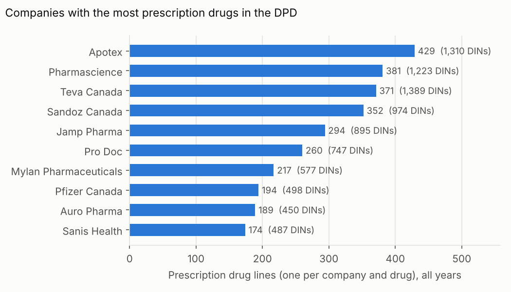
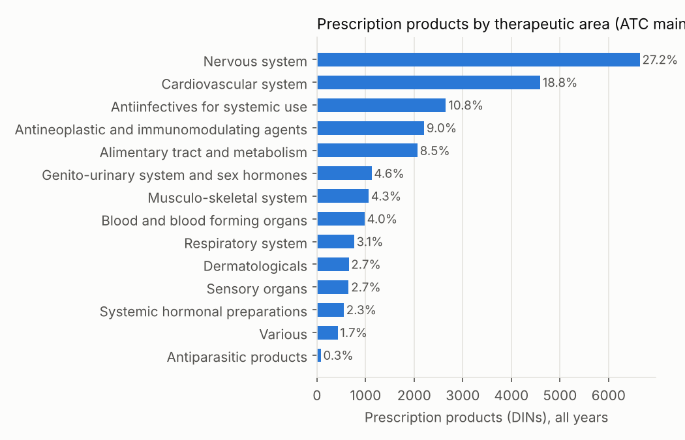
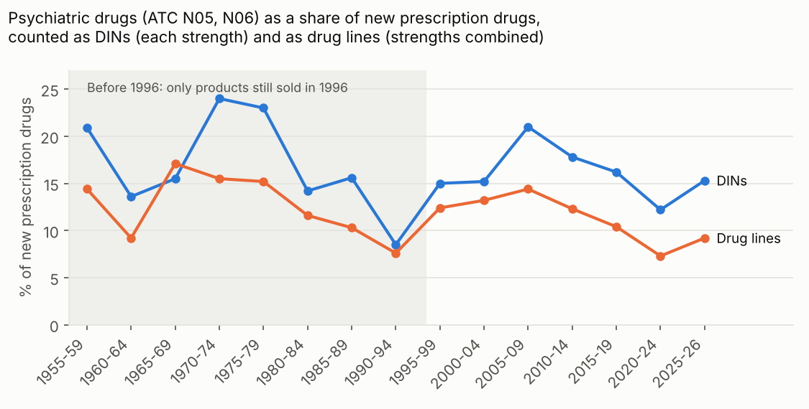
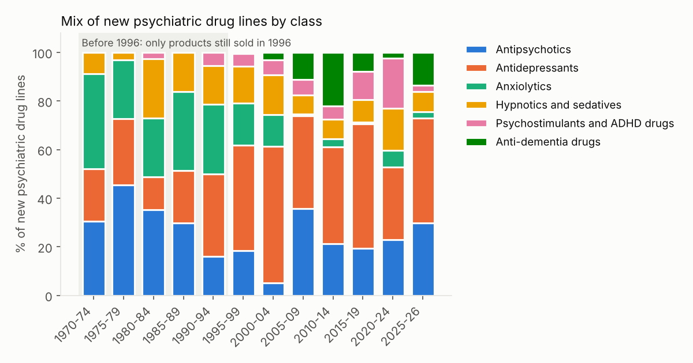

# Canadian Drug Products Database

SQL analysis of Health Canada's Drug Product Database (DPD): which companies and therapeutic areas account for the most drug products approved in Canada, and how the mix of psychiatric drugs has changed since the 1970s.

The DPD lists 50,960 human drug products, with dates from 1904 to October 2026. After removing homeopathic products and products with no ATC code, 44,177 remain; 24,462 of them are prescription drugs.

Terms such as DIN, drug line, ATC code and HHI are defined in [Key terms](#key-terms) at the end of this README.

## Results

Health Canada gives each strength and form of a drug its own DIN, so a company selling sertraline in 25, 50 and 100 mg tablets holds three DINs. The results below count both DINs and drug lines. A drug line is one company's products with the same ATC code, so those three sertraline DINs are one line. The 24,462 prescription DINs make up 9,555 drug lines, an average of 2.6 DINs per line.

### Companies

Generic manufacturers hold the most prescription drugs. Apotex has the most drug lines (429, from 1,310 DINs), followed by Pharmascience (381), Teva Canada (371), Sandoz Canada (352) and Jamp Pharma (294). Teva Canada has the most DINs (1,389) because it files more strengths per drug (3.7 DINs per line against Apotex's 3.1). Pfizer Canada, with 194 lines, is the only brand-name company in the top ten.



The company with the most new prescription drug lines has changed over time: Sandoz Canada in 2000-04, Teva Canada in 2005-09, Sanis Health in 2010-14, Apotex in 2015-19 and Jamp Pharma in 2020-24. The top ten companies held 36% of new lines in 1995-99, 48% in 2005-09 and 41% in 2020-24 (Herfindahl-Hirschman index 193, 297 and 276).

### Therapeutic areas

Counting all DINs, dermatologicals are the largest ATC group (9,509 products, 21.5%), but 8,855 of those are non-prescription items such as sunscreens and skin creams; Procter & Gamble, Avon and Johnson & Johnson hold the most. Among prescription DINs, nervous system drugs lead with 6,643 (27.2%), followed by cardiovascular drugs (4,592, 18.8%), anti-infectives (2,653, 10.8%) and cancer and immune drugs (2,206, 9.0%).



### Psychiatric drugs

The DPD has 3,895 psychiatric DINs (ATC N05 and N06). Counted as DINs, psychiatric drugs rose from 15% of new prescription products in 1995-2004 to 21% in 2005-09, then fell to 12% in 2020-24. Most of the 2005-09 peak is extra strengths: generic risperidone, quetiapine and olanzapine added 254 DINs in those five years. Counted as drug lines, the psychiatric share held at 12% to 14% from 1995 to 2009 and then fell to 7% in 2020-24.



The mix within psychiatric drug lines changed in four ways:

1. Anxiolytics, mostly benzodiazepines, were 17% to 38% of new psychiatric lines from 1965 to 1999 (before 1996, surviving products only). Since 2005 they have been under 7%.
2. Antidepressants have been the largest class in every period since 1990, peaking at 56% of new lines in 2000-04, when generic paroxetine, sertraline and citalopram arrived.
3. Antipsychotics jumped from 5% of new lines in 2000-04 to 36% in 2005-09, as generic risperidone, olanzapine and quetiapine arrived.
4. ADHD drugs were 5% to 6% of new lines from 1990 to 2014, 12% in 2015-19 and 21% in 2020-24. Lisdexamfetamine (Vyvanse and its generics) accounted for 67 of the 115 new ADHD DINs in 2020-24. Of the 368 ADHD DINs ever listed, 219 are on the market today.



New psychiatric substances have slowed. Canada saw 25 new psychiatric substances in the 1990s (including sertraline, risperidone, olanzapine and quetiapine), 18 in the 2000s, 8 in the 2010s and 9 so far in the 2020s. Recent ones include esketamine (2020), the orexin-blocking sleep drugs lemborexant (2020) and daridorexant (2023), zuranolone (2025), and the Alzheimer's antibodies lecanemab (2025) and donanemab (2026). The most copied psychiatric drugs are olanzapine (278 DINs from 33 companies), quetiapine (236 from 33) and risperidone (230 from 29).

## Data

Health Canada, Drug Product Database data extracts, downloaded 26 October 2026 from https://www.canada.ca/en/health-canada/services/drugs-health-products/drug-products/drug-product-database/what-data-extract-drug-product-database.html. Four zip files, one per product status: marketed (`allfiles.zip`), approved but not yet marketed (`allfiles_ap.zip`), cancelled or inactive (`allfiles_ia.zip`) and dormant (`allfiles_dr.zip`). Each zip holds the same set of related files linked by `drug_code`: products, companies, active ingredients, status history, therapeutic class (ATC), dosage form, route, schedule, packaging, veterinary species and biosimilar flags.

Contains information licensed under the Open Government Licence – Canada.

## Definitions

A product is one DPD record (one drug identification number, or DIN). The same drug sold by ten companies in three strengths counts as thirty DINs. A drug line is one company's products with the same ATC code (view `v_line`), so the same example counts as ten lines. A line's date is the date of its earliest DIN. Neither count measures sales.

The analysis set is human drugs with an ATC code, excluding homeopathic products. Prescription products are those with any schedule other than non-prescription, ethical or homeopathic.

Psychiatric drugs are products with an ATC code in N05 (psycholeptics) or N06 (psychoanaleptics): antipsychotics (N05A), anxiolytics (N05B), hypnotics and sedatives (N05C), antidepressants (N06A), psychostimulants and ADHD drugs (N06B), combinations (N06C) and anti-dementia drugs (N06D). Lithium (N05AN) falls under antipsychotics in this scheme. Drugs used in psychiatry that sit elsewhere in the ATC system are left out, such as clonidine for ADHD (C02) and naltrexone for alcohol use disorder (N07). A substance is an ATC level 5 code, so salt forms of one drug count together.

A product's date is the earliest date in its status history. Dates before mid-1996 are year-only: they are MARKETED dates recorded as 31 December. From July 1996 on, records have exact dates, and most start with an APPROVED status. `02b_date_checks.sql` looks for a pile-up when the format changed and finds none on a single day: the most products sharing one exact date is 57 (15 August 1997). Yearly counts do peak in 1997, with 1,779 products against 1,335 in 1996 and 1,462 in 1998, spread across every month. That peak raises the 1995-99 counts, so the results compare shares within each period, not raw counts. The DPD records almost no cancellations before 1996: 7 products have a cancellation date before 1996, against 1,710 in 1996 and 3,143 in 1997. Products withdrawn before mid-1996 are therefore missing, and every product dated before 1996 was still on the market in 1996. Results for periods before 1996 describe those surviving products, grouped by the year they first went on sale, and undercount the drugs actually approved at the time. The charts shade these periods. The last period, 2025-26, covers about 22 months.

Company names are grouped by removing punctuation and legal-form words (Inc, ULC, Ltd and similar), so "Pfizer Canada Inc." and "PFIZER CANADA ULC" count as one company. Mergers are not combined: Novopharm, which Teva bought in 2000 and later renamed Teva Canada, still appears separately with 273 prescription products, none marketed today. The company on a record is its current or last DIN owner, so an old brand can appear under the company that owns it now (olanzapine's first product is listed under Cheplapharm, not Eli Lilly).

## Database

SQLite, built by `scripts/01_build_database.py` with the Python standard library. One table per DPD file type, with an `extract` column saying which zip each row came from. The main tables are `drug` (drug_code, din, brand_name, class), `company` (company_name, country), `ingredient` (ingredient, strength), `status` (status, history_date), `therapeutic_class` (tc_atc_number, tc_atc) and `schedule`. The build also loads `dosage_form`, `route`, `pharm_standard`, `package`, `vet_species`, `biosimilar` and `inactive_product`. Every table joins on `drug_code`.

Many columns are mostly empty, and the build keeps them as NULL without filling them in. The DPD leaves a field blank when it does not apply: French names (`_f` columns) only where they differ from the English, lot numbers and expiry dates only for products released by lot, and address lines a company does not have. Nine columns are empty in every row of this release: the six size and type columns in `package` (only `product_information` is filled), `strength_type` and `strength_type_f` in `ingredient`, and `tc_atc_f` in `therapeutic_class`. None of these columns is used in the analysis. The columns the analysis does use are checked in `02_data_checks.sql`: no product lacks a company or a status date, and the 6,782 human products without an ATC code are excluded.

Lookup tables added by the build: `atc_level1` (WHO ATC main groups), `psych_class` (N05/N06 level 3 classes) and `company_clean` (grouped company names). `sql/00_views.sql` joins the tables into `v_product` (one row per product), `v_human` (human drugs), `v_analysis` (the analysis set) and `v_line` (one row per drug line).

## How to run

```bash
# Put the four zips in data/raw/, then:
python scripts/01_build_database.py
python scripts/02_run_queries.py      # writes results/*.csv
python scripts/03_make_charts.py      # writes images/*.png (needs matplotlib)
```

`tests/make_fake_extracts.py` writes small random zips in the DPD layout for testing the code without the real files.

## Queries

- `01_table_counts.sql`: Rows per table and extract.
- `02_data_checks.sql`: Products missing a company, ATC code or date, and the size of the analysis set.
- `02b_date_checks.sql`: Products per first year, year-only dates and the largest same-day count.
- `03_top_companies.sql`: Companies with the most products.
- `03b_top_companies_rx.sql`: Companies with the most prescription drug lines and DINs.
- `04_therapeutic_areas.sql`: Products by ATC main group, prescription and non-prescription.
- `05_area_by_period.sql`: Therapeutic area mix by five-year period.
- `06_top_companies_by_area.sql`: Top five companies in each area.
- `07_concentration_by_period.sql`: Top-10 share and Herfindahl-Hirschman index of new prescription drug lines by period.
- `08_psych_share_by_period.sql`: Psychiatric share of new prescription DINs and drug lines by period.
- `09_psych_mix_by_period.sql`: Psychiatric class mix of DINs and drug lines by period.
- `10_psych_ingredient_entry.sql`: First Canadian product for each psychiatric substance.
- `11_psych_top_companies_by_decade.sql`: Top psychiatric companies by decade.
- `12_psych_status.sql`: Current status of psychiatric products by class.
- `13_psych_new_substances_by_decade.sql`: New psychiatric substances per decade.

## Key terms

- Analysis set: The products this project analyses: human drugs with an ATC code, excluding homeopathic products (44,177 products).
- Anatomical Therapeutic Chemical (ATC) classification: The World Health Organization's system for grouping drugs, with five levels. For sertraline, level 1 is N (nervous system), level 2 is N06 (psychoanaleptics), level 3 is N06A (antidepressants), level 4 is N06AB (selective serotonin reuptake inhibitors) and level 5 is N06AB06 (sertraline itself).
- Anti-dementia drugs (N06D): Drugs for Alzheimer's disease and other dementias, such as donepezil, memantine and the antibodies lecanemab and donanemab.
- Antidepressants (N06A): Drugs for depression, including selective serotonin reuptake inhibitors (SSRIs) such as fluoxetine, sertraline and citalopram.
- Antipsychotics (N05A): Drugs for schizophrenia, bipolar disorder and other psychotic illness, such as haloperidol, risperidone, olanzapine and quetiapine. Lithium is also classed here.
- Anxiolytics (N05B): Drugs for anxiety. Most in the DPD are benzodiazepines such as lorazepam, alprazolam and diazepam.
- Biosimilar: A biologic drug (made from living cells) shown to be highly similar to a biologic already approved in Canada.
- Brand-name drug: The first version of a drug, sold by the company that developed it or now owns it, such as Zoloft for sertraline.
- Common table expression (CTE): A named subquery written with WITH at the top of a SQL query. Most queries in `sql/` use CTEs to build their result in steps.
- Drug identification number (DIN): The eight-digit number Health Canada gives a drug product before it can be sold. Each combination of company, brand name, active ingredients, strength, dosage form and route gets its own DIN.
- Drug line: This project's unit for combining strengths: one company's products with the same ATC code. Three strengths of one company's sertraline are three DINs and one drug line.
- Drug Product Database (DPD): Health Canada's public database of drug products approved for sale in Canada, including human, veterinary, disinfectant and radiopharmaceutical products.
- Extract: One of the four zip files Health Canada publishes, split by product status: marketed, approved (authorized but not yet sold), dormant (not being sold, but the DIN is kept) and inactive (cancelled).
- Generic drug: A copy of a brand-name drug with the same active ingredient, sold once patents and data protection have expired. Health Canada requires the company to show it acts in the body the same way as the brand-name drug.
- Herfindahl-Hirschman index (HHI): A measure of how concentrated a market is: the sum of each company's squared percentage share. It runs from near 0 (many small companies) to 10,000 (one company holds everything).
- Homeopathic product: A product made from highly diluted substances under homeopathic principles. These are listed in the DPD but mostly lack ATC codes, so this project excludes them.
- Hypnotics and sedatives (N05C): Sleep drugs and sedatives, such as zopiclone, zolpidem, midazolam and the orexin receptor blockers lemborexant and daridorexant.
- Join: A SQL operation that combines rows from two tables on a shared column. Every DPD table joins on `drug_code`.
- Open Government Licence – Canada: The licence Health Canada releases the DPD under. It allows copying, changing and sharing the data with attribution.
- Prescription product: In this project, a product with any schedule other than non-prescription, ethical or homeopathic. Ethical products are non-prescription drugs marketed mainly to health professionals.
- Psychiatric drugs: In this project, products with an ATC code in N05 (psycholeptics, which calm or sedate) or N06 (psychoanaleptics, which stimulate or lift mood).
- Psychostimulants and ADHD drugs (N06B): Drugs mainly for attention deficit hyperactivity disorder, such as methylphenidate, lisdexamfetamine and atomoxetine, plus drugs for wakefulness such as modafinil.
- Schedule: The legal category a drug is sold under, such as prescription, non-prescription, or controlled substances under the Controlled Drugs and Substances Act.
- Status history: The DPD's record of each status change for a product (approved, marketed, dormant, cancelled) with its date. This project dates each product by its earliest status.
- Substance: An ATC level 5 code. Different salt forms of one drug (for example, two forms of paroxetine) count as one substance.
- Survivorship bias: Distortion that comes from looking only at items that lasted. The DPD has almost no products cancelled before 1996, so earlier periods show only drugs still sold in 1996.
- Therapeutic area: In this project, an ATC level 1 group, such as nervous system or cardiovascular system.
- View: A saved SQL query that behaves like a table. `v_product`, `v_human`, `v_analysis` and `v_line` are views.
- Window function: A SQL function that calculates across a set of related rows without collapsing them, such as ROW_NUMBER() for ranking or SUM() OVER (PARTITION BY ...) for shares within a group.
